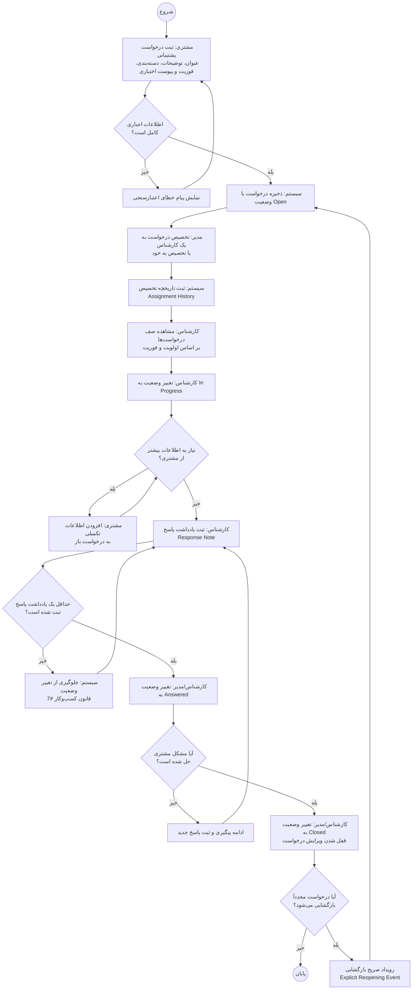
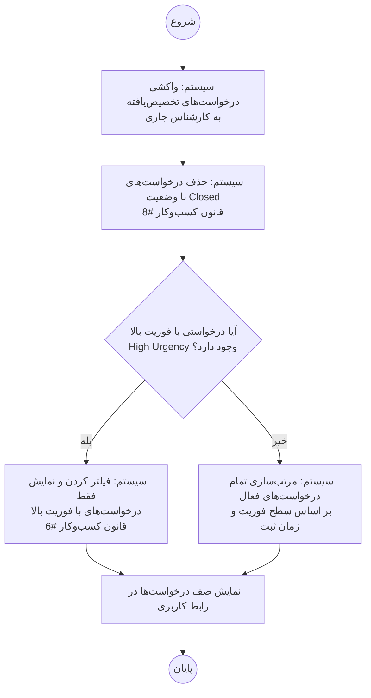
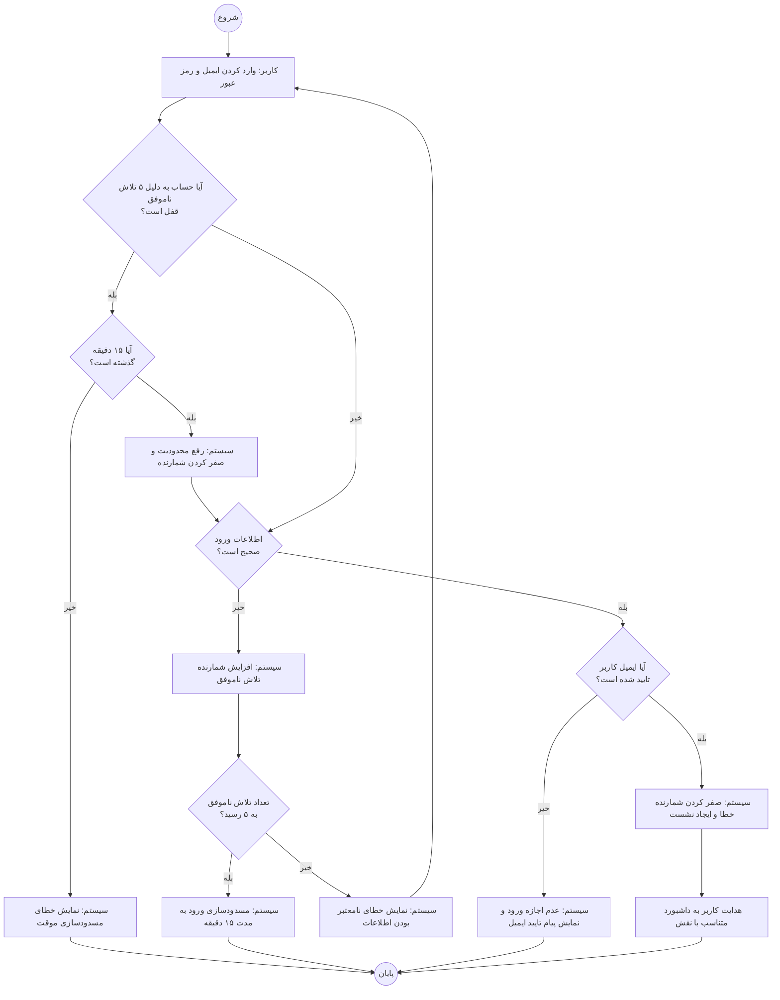
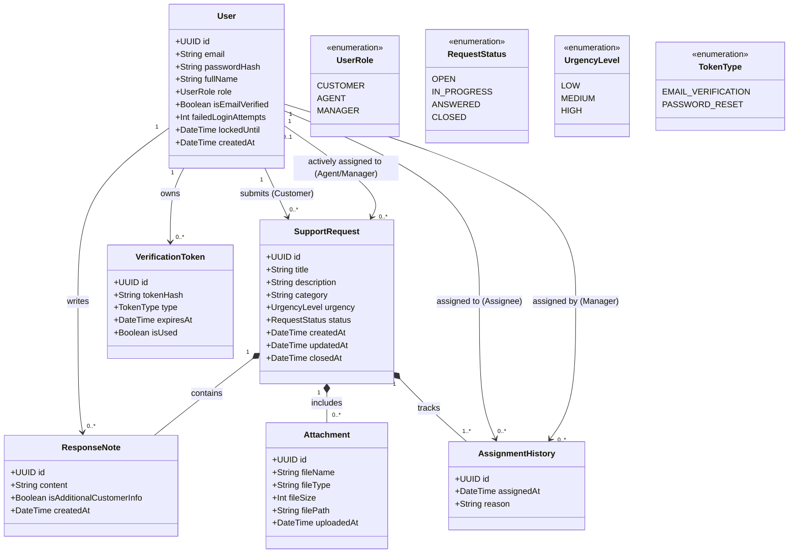

# System Analysis
## Support Request Tracking System

این سند شامل تحلیل رفتاری و ساختاری **سیستم پیگیری درخواست‌های پشتیبانی (Support Request Tracking System)** است و مطابق با مستندات نیازمندی‌ها (`requirements.md`) و چشم‌انداز پروژه (`vision.md`) تدوین شده است.

---

## 1. نمودارهای فعالیت (Activity Diagrams)

با توجه به تمرکز آموزشی پروژه بر مدیریت چرخه حیات درخواست‌ها، قوانین تخصیص کارشناس و کنترل دسترسی، فرآیندهای کلیدی سیستم در قالب سه نمودار فعالیت مدل‌سازی شده‌اند.

### 1.1. نمودار فعالیت چرخه حیات کامل درخواست پشتیبانی (End-to-End Request Lifecycle)
این نمودار فرآیند کامل از لحظه ثبت درخواست توسط مشتری تا تخصیص توسط مدیر، بررسی و پاسخ‌دهی توسط کارشناس، و در نهایت بستن یا بازگشایی مجدد درخواست را نمایش می‌دهد.

---

### 1.2. نمودار فعالیت صف درخواست‌های کارشناس (Agent Request Queue Logic)
این نمودار منطق دقیق نمایش صف کارشناس بر اساس قوانین کسب‌وکار شماره ۵، ۶ و ۸ (فیلتر کردن درخواست‌های بسته، اولویت‌بندی بر اساس سطح فوریت و نمایش انحصاری درخواست‌های با فوریت بالا در صورت وجود) را نشان می‌دهد.

---

### 1.3. نمودار فعالیت احراز هویت و ورود به سیستم (Authentication & Login Security)
این نمودار فرآیند ثبت‌نام، تایید ایمیل و مکانیزم امنیتی مسدودسازی موقت حساب پس از ۵ بار تلاش ناموفق را مدل‌سازی می‌کند.

---

## 2. مدل مفهومی دامنه (Conceptual Domain Model)

مدل مفهومی دامنه، موجودیت‌های اصلی کسب‌وکار، ویژگی‌های کلیدی آن‌ها و روابط بین آن‌ها را مستقل از جزئیات پیاده‌سازی پایگاه‌داده نمایش می‌دهد.

### 2.1. نمودار کلاس مفهومی (Conceptual Class Diagram)

---

### 2.2. تشریح موجودیت‌های دامنه (Domain Entities Dictionary)

| موجودیت (Entity) | نقش و مسئولیت در دامنه سیستم | قوانین کلیدی مرتبط |
| :--- | :--- | :--- |
| **User** | نماینده تمام کاربران سیستم (مشتری، کارشناس پشتیبانی، مدیر پشتیبانی). تفکیک دسترسی‌ها از طریق صفت `role` انجام می‌شود. | - ایمیل باید یکتا باشد. - مشتری نمی‌تواند نقش خود را تغییر دهد. - مدیر می‌تواند حساب کارشناس بسازد یا مشتری را ارتقا دهد. |
| **SupportRequest** | موجودیت محوری سیستم که درخواست پشتیبانی ثبت‌شده توسط مشتری را مدل می‌کند. | - در هر لحظه حداکثر **یک** مسئول فعال (`actively assigned to`) دارد. - درخواست در وضعیت `Closed` قابل ویرایش نیست. |
| **ResponseNote** | پیام‌ها، پاسخ‌های کارشناسان و همچنین اطلاعات تکمیلی ثبت‌شده توسط مشتری در طول بررسی درخواست. | - انتقال از `In Progress` به `Answered` نیازمند وجود حداقل یک یادداشت پاسخ از سمت کارشناس/مدیر است. |
| **AssignmentHistory** | ثبت تاریخچه کامل تخصیص‌ها و تغییر مسئولیت هر درخواست به همراه زمان و شخص تخصیص‌دهنده. | - هرگونه تغییر در مسئول فعلی درخواست باید در این موجودیت ثبت و نگهداری شود. |
| **Attachment** | فایل‌ها و تصاویر پیوست‌شده توسط مشتری برای توضیح بهتر مشکل. | - به یک درخواست مشخص وابسته است (رابطه Composition). |
| **VerificationToken** | توکن‌های امنیتی یک‌بارمصرف و دارای زمان انقضا برای تایید ایمیل و بازیابی رمز عبور. | - پس از استفاده یا انقضای زمان، نامعتبر می‌شود. |